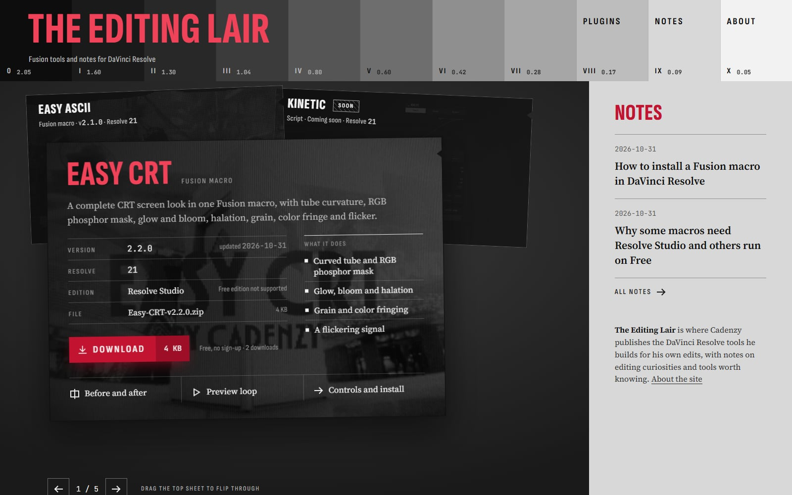
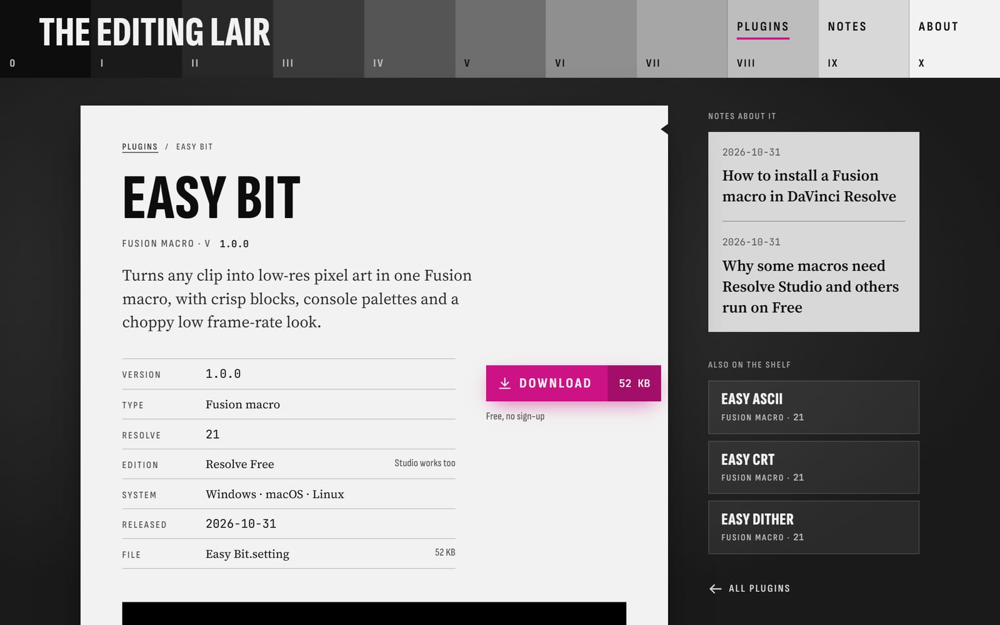

# The Editing Lair

A small static site where I publish the DaVinci Resolve tools I build for my own edits, mostly Fusion macros, along with short notes on editing and Resolve. Built by Matheus Frazatto, who signs the plugins as Cadenzy.

**Live site:** https://matheusfrazatto.github.io/TheEditingLair/



## Why it exists

I edit video in DaVinci Resolve and kept building Fusion macros to get looks I could not find, or could not find for free. Sharing them as loose files on a drive did not scale: people need to know which Resolve version and edition a macro needs, where to install it, and what each control does.

So I built a home for them. Each macro gets a page with its requirements, its controls and their defaults, install steps for every OS, a changelog, and a direct download. There is no account, no sign-up, no tracking and no backend. It is a static site served by GitHub Pages.

I work in tech, so the site is also a deliberate exercise: a content-driven site with a strong visual identity, real interaction design, and the kind of constraints (no server, a sub-path deployment, a non-technical authoring flow) that come up in real projects.

## The plugins

| Plugin | What it does | Resolve edition |
|---|---|---|
| [Easy CRT](https://matheusfrazatto.github.io/TheEditingLair/plugins/easy-crt/) | Full CRT screen look: tube curvature, RGB phosphor mask, glow, bloom, halation, fringe and flicker | Studio |
| [Easy ASCII](https://matheusfrazatto.github.io/TheEditingLair/plugins/easy-ascii/) | Rebuilds footage out of text characters, with 13 character sets and 15 palettes | Free and Studio |
| [Easy Dither](https://matheusfrazatto.github.io/TheEditingLair/plugins/easy-dither/) | Ordered dithering with six procedural patterns and duotone presets | Free and Studio |
| [Easy Bit](https://matheusfrazatto.github.io/TheEditingLair/plugins/easy-bit/) | Pixel art with crisp blocks and CGA, Game Boy, NES and PICO-8 palettes | Free and Studio |

The plugins are free to use in any project, personal or commercial. Please do not sell them or share the files themselves; link to the plugin page instead. Found a problem or have an idea? [Open an issue](https://github.com/MatheusFrazatto/TheEditingLair/issues/new/choose).

A Fusion macro is a `.setting` file: a Lua table describing a group of nodes and the controls exposed in the Inspector. Some things I care about when building them:

- **Resolution independent.** Sizes such as the phosphor mask, dither cells and pixel blocks are computed from the frame size in expressions, so a preset looks the same at 1080p and 4K, and block sizes always land on whole pixels.
- **Procedural instead of bundled.** Easy Dither generates its Bayer, line and dot patterns in a Custom Tool instead of loading an image, so there is a single file to install.
- **Cheap to render.** Easy Bit does its color work on a downscaled image, one pixel per block, and its palette matching (up to 55 colors) is generated by a script as balanced expression trees, keeping nesting shallow instead of one long chain.
- **One clean Inspector.** Every control sits on a single page, in collapsible sections ordered by how often you touch them, with a header carrying the version and links back to this site.

## Tech stack

| | |
|---|---|
| Framework | [Astro 7](https://astro.build) with static output |
| Language | TypeScript |
| Content | Astro content collections (Markdown + frontmatter), validated with Zod schemas |
| Images | `astro:assets` + sharp: responsive WebP sets generated at build time |
| Motion | [anime.js 4](https://animejs.com): timelines, text splitting, pointer-driven animatables |
| Type | Self-hosted variable fonts through Fontsource (no third-party font requests) |
| Feeds | `@astrojs/rss` and `@astrojs/sitemap` |
| Hosting | GitHub Pages, deployed by GitHub Actions on every push to `main` |

There is no UI framework and no client-side router. Pages are plain HTML and CSS, and the only JavaScript is a few small, progressively enhanced scripts.

## Engineering highlights

**Content is data.** A plugin is one Markdown file. Its frontmatter is checked against a schema at build time: version, Resolve version, edition, OS list, exposed controls, cover image, changelog. A typo fails the build instead of shipping a broken page. Access is a discriminated union: a free plugin points to a file, while a paid one must point to an external store, so the site can never host a paid file or handle payments.

**Works under a sub-path.** GitHub Pages serves the site from `/TheEditingLair/`. The workflow reads the origin and base path from `actions/configure-pages` and passes them to Astro, and every internal link goes through one `withBase()` helper. The same build also works at a domain root.

**A draggable sheet pile instead of a slider.** The home page shows the plugins as a pile of paper sheets you can drag, flick, click or step through with the arrow keys.

- Pointer events with pointer capture handle the drag. A release counts as a flip after a long pull, or a short pull above a speed threshold measured over the last 100 ms of movement.
- The left sheet is always the next plugin and the right sheet the previous one, so the pile turns the same way however you navigate it.
- Hidden sheets are `inert`, the region uses carousel roles, and a live region announces the current plugin.
- **No layout shift.** The sheets have different heights, so the pile measures every sheet off-screen at its final width, with a `ResizeObserver`, and reserves the tallest height. The incoming sheet is also laid out at its final width while it animates, so the section below never moves: measured frame by frame through every flip at four viewport sizes, it stays put to the pixel.

**Motion that respects the reader.** A short intro plays once per session, can be skipped with any key or click, and has failsafe timeouts so the page can never get stuck behind it. Everything honors `prefers-reduced-motion`. The cover images sit in black and white and develop into color on hover or keyboard focus.

**Before and after, on every plugin page.** The cover is a comparison of the same frame with and without the effect, split by a divider you drag with a mouse or finger, or move with the arrow, Page and Home/End keys. It is an ARIA slider that reports how much of the original is showing, the vertical page scroll still works on touch screens, and a single sweep of the divider hints that it moves the first time it comes into view (skipped with reduced motion or once you touch it). A full-screen button uses the Fullscreen API, and falls back to a layer over the page where the API is missing, as on iPhone.

**Previews that play only when seen.** Each plugin page has a short silent loop of the effect. The video loads nothing until it scrolls into view, plays while at least half of it is on screen and pauses when it leaves. A visitor's pause, or `prefers-reduced-motion`, keeps it still until they press play. The poster is the first frame, so the loop starts without a jump, and without JavaScript the browser's own controls remain.

**Found and followed.** Plugin pages describe themselves to search engines as schema.org `SoftwareApplication` data (version, requirements, free offer, download), notes as `BlogPosting`. A second RSS feed carries one item per plugin release, linked to its changelog entry, so people can follow new versions.

**Links that preview well.** Every page carries Open Graph and Twitter card tags. A plugin page shares its cover, resized at build time; other pages share a site card in the same step-wedge look.

**Issue forms instead of a contact form.** There is no backend, so problems and requests go to GitHub Issues through forms. The "Report a problem" link on each plugin page pre-fills the plugin and its version.

**Counted downloads without a backend.** Each plugin version is a GitHub Release, and the Download button points at its asset, so GitHub counts every download. The plugin page asks the public Releases API for the total across all versions, caches it for the session, and leaves the note as it was if GitHub does not answer. Release assets cannot keep spaces in their names, and Resolve shows the file name as the effect name, so `npm run release` ships each macro inside a zip it writes itself (no dependency), under its exact name, byte for byte. It creates the release from the changelog and points the page at it, then rebuilds Easy Complete, a zip of every free plugin, as its own counted release, so the bundle never falls behind; the build log warns if it ever does.

**Downloads stay byte-identical.** `.gitattributes` marks `public/downloads/**` as binary, so line-ending conversion can never change a macro between my Resolve folder and the zip.

**Accessibility basics.** Skip link, visible focus states, semantic landmarks, ARIA table roles on the plugin table, and alt text on every cover.



## Project structure

```text
src/
  content/
    plugins/        one Markdown file per plugin, plus cover images
    posts/          notes
  content.config.ts content schemas
  components/       sheet pile, plugin table, facts table, download button, masthead
  layouts/          base page layout
  pages/            home, plugins, notes, about, RSS, 404
  scripts/          intro and page motion
  lib/              base-path links, content queries, formatting
  styles/           design tokens and global styles
public/
  downloads/        the current .setting of each plugin, the source of its release zip
  media/            silent preview loops, one folder per plugin
.github/workflows/  build and deploy to GitHub Pages
.github/ISSUE_TEMPLATE/  problem and request forms
scripts/release.mjs zip a plugin and publish it as a GitHub Release
```

## Running it locally

Requires Node.js 22.

```sh
npm ci
npm run dev      # dev server at http://localhost:4321
npm run check    # type and content checks
npm run build    # static build into dist/
npm run preview  # serve the build
```

To build for the GitHub Pages sub-path locally:

```sh
SITE_URL=https://matheusfrazatto.github.io BASE_PATH=/TheEditingLair npm run build
```

## Publishing a plugin

1. Put the `.setting` file in `public/downloads/<slug>/`.
2. Add a cover image to `src/content/plugins/images/`.
3. Optionally add the same frame without the effect as `<slug>-original.jpg` and point `coverOriginal` at it to get the before/after comparison.
4. Optionally add a short silent loop as `public/media/<slug>/preview.mp4`, with its first frame as `<slug>-preview.jpg`, and point `preview` at both.
5. Create `src/content/plugins/<slug>.md` with the frontmatter (the schema in `src/content.config.ts` lists every field) and write the page body.
6. Run `npm run release -- <slug>`. It zips the `.setting`, creates the GitHub Release `<slug>-v<version>` with the changelog notes, and updates the download, file name and size on the page. It then rebuilds Easy Complete (`src/data/easy-complete.json`); pass `--no-bundle` to skip that.
7. Run `npm run check`, then push to `main`. GitHub Actions builds and deploys the site.

Setting `draft: true` keeps a plugin or note visible in the dev server only.

## License

The website's source code is [MIT licensed](LICENSE). The plugins, images, preview videos and written content are not: the plugins are free to use in any project, commercial included, but may not be resold or redistributed.

---

DaVinci Resolve and Fusion are trademarks of Blackmagic Design. This is an independent project, not affiliated with or endorsed by Blackmagic Design.
